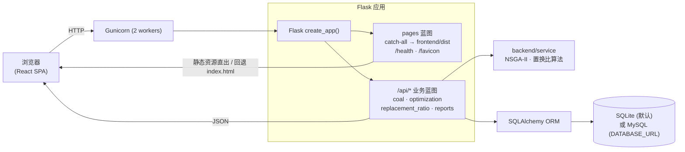

# 架构与技术栈说明

> 产品：**煤粉数据库管理及配煤优化控制台**（GitHub 仓库 `coal-database-blending-system-web`，当前版本 `v1.0.0`）
>
> 相关文档：[项目说明](../README.md) · [API 参考](./API_REFERENCE.md) · [部署说明](./DEPLOYMENT.md) · [用户指南](./USER_GUIDE.md) · [前端说明](../frontend/README.md)

## 1. 系统概览

本系统是一个**单容器、前后端一体**的 Web 应用：前端是 Vite + React + TypeScript 单页应用（SPA，源码在 [`frontend/`](../frontend)），后端是统一以 `/api` 为前缀的 Flask JSON API。生产环境由 Flask + Gunicorn 一个容器同时承担两件事——托管前端构建产物 `frontend/dist`（含 history 路由回退），并对外提供 `/api/*` 接口。数据默认落在本地 SQLite（`data/coal_system.db`），也可通过环境变量 `DATABASE_URL` 切到 MySQL（`PyMySQL` 驱动）；首次访问接口时自动建表并从 `data/test_coal_datas.csv` 播种。旧的 Jinja/Bootstrap 服务端渲染页面已整体移除，只保留纯 API + SPA 的形态。



## 2. 技术栈

### 前端

| 库 / 工具 | 用途 |
| --- | --- |
| React 18 + TypeScript | 组件化 UI 与类型安全 |
| Vite | 开发服务器、构建打包（产物 `frontend/dist`） |
| React Router (`react-router-dom`) | 客户端 history 路由 |
| TanStack Query (`@tanstack/react-query`) | 服务端状态：缓存、重试、后台刷新 |
| Apache ECharts (`echarts`) | Pareto 前沿、配比、指标可视化 |
| CSS 设计令牌（`styles/tokens.css`） | 双主题变量体系，`useChartPalette` 让图表跟随换肤 |

### 后端

| 库 | 用途 |
| --- | --- |
| Flask 3 | 应用工厂、蓝图、JSON API |
| Flask-SQLAlchemy / SQLAlchemy 2 | ORM 与数据库会话 |
| Flask-Migrate | 迁移（`migrations/`），模型元数据在启动时被发现 |
| Flask-Cors | 对 `/api/*` 开放跨域 |
| NumPy / SciPy | NSGA-II 计算、`linprog` 线性可行性预检查 |
| pandas / openpyxl / xlrd | CSV/Excel 导入导出与报表 |
| python-dotenv | 读取 `.env` 环境变量 |
| PyMySQL | 可选 MySQL 驱动（配合 `DATABASE_URL`） |

### 构建与发布

| 工具 | 用途 |
| --- | --- |
| Gunicorn | 生产 WSGI 服务器（`wsgi:app`，2 worker，超时 180s） |
| Docker（多阶段） | 阶段 1 用 `node:20-slim` 构建 SPA，阶段 2 用 `python:3.11-slim` 运行 Flask，产物拷入 `frontend/dist` |
| GitHub Actions `ci.yml` | PR 触发，安装 `requirements-dev.txt` 后 `pytest` |
| GitHub Actions `release-on-main.yml` | `main` 推送后跑 Python Semantic Release，再构建镜像、推 GHCR、附资产 |
| Python Semantic Release | 依 Conventional Commits 自动定版、打 tag、建 Release（`pyproject.toml` 内 `major_on_zero=true`） |

## 3. 请求流转

**页面路由（非 `/api`）**：由 `pages` 蓝图的 catch-all 路由 `spa()`（[`app/routes/pages.py`](../app/routes/pages.py)）处理。若请求路径对应 `frontend/dist` 下真实存在的文件（做了目录穿越防护），直接返回该静态资源；否则回退到 `index.html`，把路由交给前端 React Router（history 模式）。当 `frontend/dist` 尚未构建（例如 CI 只跑后端测试）时，返回一个轻量占位页并以 `200` 响应。

**接口路由（`/api/*`）**：`spa()` 会主动对以 `api/` 开头的未匹配路径 `abort(404)`，避免被 SPA 吞掉。真正的接口由四个业务蓝图承接，它们全部以 `url_prefix="/api"` 注册（见 [`app/routes/__init__.py`](../app/routes/__init__.py)）：`coal_bp`、`optimization_bp`、`replacement_ratio_bp`、`reports_bp`。具体端点见 [API 参考](./API_REFERENCE.md)。

**CORS**：在应用工厂里对 `/api/*` 开放（`resources={r"/api/*": {"origins": "*"}}`）。JSON 输出关闭了 ASCII 转义（`app.json.ensure_ascii = False`），中文直接返回。

**健康检查**：`GET /health`（注意不带 `/api` 前缀，由 `pages` 蓝图提供）返回 `status`、`app`、`storage_mode` 与 `coal_count`。Dockerfile 的 `HEALTHCHECK` 即请求该端点判断存活。

## 4. 后端分层

后端代码分布在两个包，`app` 是应用骨架，`backend` 是业务与算法实现，两者通过薄兼容层衔接：

- **`app/`（应用工厂 / 配置 / 模型 / 蓝图注册）**
  - `create_app()`（[`app/__init__.py`](../app/__init__.py)）初始化扩展（`db` / `migrate` / `cors`）、导入模型、注册蓝图与错误处理、挂载启动钩子。
  - `app/config.py` 定义 `Config` / `DevelopmentConfig` / `ProductionConfig`，含 `SPA_DIST_DIR`、`COAL_DATA_PATH`、`SQLALCHEMY_DATABASE_URI`（默认 SQLite，`DATABASE_URL` 覆盖）等。
  - `app/models/` 定义 ORM：`Coal`、`OptimizationHistory`、`ReplacementRatioHistory`、`UploadFile`。
  - `app/routes/coal_management.py`、`optimization.py`、`replacement_ratio.py`、`reports.py` 都是**兼容导出层**——只做 `from backend.routes.* import <blueprint>` 的再导出，真实实现位于 `backend/routes/`。`app/routes/pages.py` 与 `errors.py` 则是 SPA 托管与统一错误处理的真实实现。
- **`backend/`（业务路由 / 算法服务 / 工具）**
  - `backend/routes/` 是各蓝图端点的实现（煤种 CRUD、优化、置换比、报表）。
  - `backend/service/` 是算法核心：`blending_service.py`（NSGA-II 多目标混煤）、`replacement_ratio_service.py`（理论/实际置换比）。
  - `backend/utils/` 提供 Excel/文件/报表/校验工具。

**SQLite 播种机制**：应用注册了 `before_request` 钩子调用 `ensure_coal_data_initialized()`（[`app/services/coal_data_service.py`](../app/services/coal_data_service.py)）。它先 `db.create_all()` 建表，若 `Coal` 表为空则从 `data/test_coal_datas.csv` 读入并导入（保留 CSV 序号），并在应用对象上打标记 `_coal_data_initialized` 避免重复执行。CSV 列名支持中英文别名映射（如 `煤种名称`/`name`、`热值(kcal/kg)`/`calorific_value`），因此首次访问任意接口即可获得可用数据。

## 5. 数据模型概览

三张核心表定义于 `app/models/`。字段与含义摘录如下。

**`Coal`（表 `coal_data`，[`app/models/coal.py`](../app/models/coal.py)）** — 煤种基础信息

| 字段 | 类型 | 含义 |
| --- | --- | --- |
| `id` | Integer PK | 主键 |
| `name` | String, 唯一 | 煤种名称 |
| `type` | String | 煤种类型 |
| `price` | Float | 价格（元/吨） |
| `calorific_value` | Float | 热值（kcal/kg） |
| `ash_content` | Float | 灰分（%） |
| `volatile_matter` | Float | 挥发分（%） |
| `fixed_carbon` | Float | 固定碳（%） |
| `total_sulfur` | Float | 全硫（%） |
| `total_moisture` / `air_dry_moisture` | Float | 全水分 / 空干基水分（%） |
| `supplier` | String | 供应商/产地 |
| `hgi` / `burnout_rate` | Float | 可磨性 HGI / 燃尽率（%） |
| `carbon_content` / `hydrogen_content` / `nitrogen_content` | Float | 元素分析：含碳/氢/氮量（%） |
| `created_at` / `updated_at` | DateTime | 创建 / 更新时间 |

> 接口输出会额外附带别名字段 `moisture`（=`total_moisture`）、`mad`（=`air_dry_moisture`），前端两套命名皆可用。

**`OptimizationHistory`（表 `optimization_history`，[`app/models/optimization.py`](../app/models/optimization.py)）** — 混煤优化结果历史

| 字段 | 类型 | 含义 |
| --- | --- | --- |
| `id` | Integer PK | 主键 |
| `timestamp` | String | 优化时间戳 |
| `coal_names` / `optimal_ratios` | Text(JSON) | 参与煤种名称 / 最优配比 |
| `constraints` | Text(JSON) | 本次约束条件 |
| `total_price` / `total_heat` / `total_ash` / `total_volatile` / `total_fixed_carbon` / `total_sulfur` | Float | 混合后各指标 |
| `performance_price_ratio` | Float | 性价比 |
| `iterations` / `time_taken` / `fitness_value` | Integer/Float | 迭代代数 / 耗时 / 适应度 |
| `constraints_satisfied` | Boolean | 是否满足约束 |
| `request_payload` / `result_payload` | Text(JSON) | 原始请求 / 完整结果（含 Pareto 前沿） |
| `created_at` | DateTime | 记录时间 |

**`ReplacementRatioHistory`（表 `replacement_ratio_history`，[`app/models/replacement_ratio_history.py`](../app/models/replacement_ratio_history.py)）** — 置换比计算历史

| 字段 | 类型 | 含义 |
| --- | --- | --- |
| `id` | Integer PK | 主键 |
| `calculation_type` | String | 计算类型（理论 `theory` / 实际 `actual`） |
| `calculation_mode` | String | 计算模式（如 `theory` / `basic` / `advanced`） |
| `ratio_value` | Float | 计算得到的置换比 |
| `parameter_summary` | Text | 参数摘要（便于历史列表展示） |
| `request_payload` / `result_payload` | Text(JSON) | 原始请求 / 完整结果 |
| `created_at` | DateTime | 记录时间 |

## 6. 混煤优化算法（高层）

混煤优化采用 **NSGA-II 多目标 Pareto** 搜索，实现于 [`backend/service/blending_service.py`](../backend/service/blending_service.py)（入口类 `OptimizedSmartBlendingAlgorithm`，`objective_type = pci_pareto_nsga2_v1`）。

- **三个目标**：成本（`total_price`，越低越好）、热值（`total_heat`，越高越好）、质量风险惩罚（`quality_penalty`，由灰分/全硫/挥发分/固定碳偏离工艺窗口综合而来，越低越好）。目标向量以 `(cost, -heat, quality_penalty)` 参与非支配排序。
- **约束**：热值/灰分/挥发分/固定碳/全硫/成本的上下限，以及单煤种配比上下限、总配比等于 100%。先用 SciPy `linprog`（`method='highs'`）做**线性可行性预检查**并求出最低成本可行 seed；若不可行，会逐组约束诊断冲突来源并直接返回 `no_feasible_solution`。
- **Pareto 前沿**：`NSGA2BlendingOptimizer` 用快速非支配排序 + 拥挤度距离演化种群，返回第一前沿的可行解集合（对两煤种组合走快速配比扫描的捷径以省时）。前沿按 `(成本↑, 热值↓, 质量惩罚↑)` 排序并截断为若干候选（`pareto_solution_limit`，默认 20）。
- **推荐解选取**：对候选做各目标 min-max 归一化，取到「理想点」欧氏距离最小者作为推荐方案（平局时再比成本）。响应同时返回推荐解与整条 Pareto 候选集，供前端画前沿散点并让用户在成本/热值/质量之间权衡。

## 7. 前端架构

- **路由与页面**：入口 `main.tsx` 挂 `BrowserRouter` + `QueryClientProvider` + `ThemeProvider` + `ToastProvider`；`App.tsx` 定义左侧导航与 `Routes`，页面按需 `lazy` 加载。页面在 [`frontend/src/pages/`](../frontend/src/pages)：`Dashboard`、`CoalDatabase`、`SmartBlending`、`ReplacementRatio`、`HistoryBlending`、`HistoryReplacement`。
- **服务端状态**：统一用 TanStack Query（`lib/query.ts` 建 `queryClient` 与集中式 `qk` query keys），默认 `staleTime` 30s、失败重试 1 次、关闭窗口聚焦刷新；`Topbar` 每 60s 轮询 `/health` 显示在线状态。
- **CSS 设计令牌与双主题**：所有颜色/字体/半径/阴影在 `styles/tokens.css` 以 CSS 变量声明。默认暗色（**Furnace Console**），`[data-theme='light']` 覆盖为亮色（**Foundry Daylight**）。`lib/theme.tsx` 的 `ThemeProvider` 把主题写到 `<html data-theme>` 并记忆到 `localStorage`（键 `cbos_theme`），一键切换。
- **图表跟随换肤**：`components/ui/Chart.tsx` 的 `useChartPalette()` 直接 `getComputedStyle` 读取当前主题的 CSS 变量（并按主题切换分类色板），因此 ECharts 的颜色始终与 CSS 主题一致；主题切换是同步 `apply`，保证重渲染时图表取到新色值。
- **演示模式与 mock 引擎**：由 `VITE_USE_MOCK` 控制（开发 `.env.development` 默认 `true`，生产 `.env.production` 为 `false`）。`lib/mock/engine.ts` 内置合成的 NSGA-II 与置换比引擎、以 `localStorage` 持久化的数据存储，无需后端即可完整体验；`Topbar` 在演示模式会显示「演示数据」徽标。
- **API 客户端真实/演示切换**：`lib/api.ts` 顶部计算 `USE_MOCK`，每个接口函数据此二选一：命中 mock 引擎，或 `fetch` 同源真实端点（`/api/*` 与 `/health`）。上层页面无需感知，切换只发生在这一层。

## 8. 目录结构

```text
repo/
├── app/                       # Flask 应用骨架
│   ├── __init__.py            # create_app 应用工厂
│   ├── config.py              # 配置类（SQLite 默认 / DATABASE_URL 覆盖）
│   ├── extensions.py          # db / migrate / cors 实例
│   ├── models/                # ORM：Coal / OptimizationHistory / ReplacementRatioHistory / UploadFile
│   ├── routes/                # pages(SPA)、errors，其余为 backend 蓝图的兼容导出
│   └── services/              # coal_data_service：建表 + CSV 播种
├── backend/                   # 业务与算法实现
│   ├── routes/                # 各蓝图真实端点（coal / optimization / replacement_ratio / reports）
│   ├── service/               # blending_service(NSGA-II)、replacement_ratio_service
│   └── utils/                 # excel / file / report / validation 工具
├── frontend/                  # Vite + React + TS 单页应用
│   ├── src/
│   │   ├── main.tsx           # 应用入口（Router/Query/Theme/Toast Provider）
│   │   ├── App.tsx            # 布局与路由
│   │   ├── pages/             # 6 个页面
│   │   ├── components/        # ui / blending / CoalForm 等组件
│   │   ├── lib/               # api、theme、query、types、mock 引擎
│   │   └── styles/tokens.css  # 设计令牌 + 双主题
│   └── .env* / dist/          # 演示开关；构建产物（生产由 Flask 托管）
├── data/                      # coal_system.db（默认）、test_coal_datas.csv（种子）
├── migrations/                # Flask-Migrate 迁移
├── static/                    # favicon 等静态资源
├── Dockerfile                 # 多阶段：构建 SPA + Flask/Gunicorn 运行
├── .github/workflows/         # ci.yml（PR 测试）、release-on-main.yml（发布）
├── requirements.txt           # 运行时依赖
├── run.py / wsgi.py           # 本地启动 / WSGI 入口
└── pyproject.toml             # Semantic Release 配置（major_on_zero=true）
```

## 9. 关键设计取舍

- **为何 SPA + 单容器**：前端已全面转向富交互（Pareto 散点、配比图、双主题、即时校验），Jinja 服务端渲染难以承载，故整体重构为 SPA 并移除旧模板。为降低部署与运维成本，不拆分独立前端服务器/CDN，而是让 Flask 用 catch-all 路由直接托管 `frontend/dist`、`/api/*` 提供接口，`docker run` 一个镜像即可跑起整套系统；同源部署也天然规避了跨域与鉴权分离的复杂度。
- **为何做演示模式**：内置合成引擎（`lib/mock/engine.ts`）让开发、评审、演示无需先起后端与数据库即可跑通全部页面与交互；真实/演示切换收敛在 `lib/api.ts` 一层，生产构建关掉 mock 后同一套页面无缝直连 `/api`。
- **为何选 NSGA-II**：混煤本质是**多目标权衡**（成本、热值、质量风险彼此冲突），单目标加权很难覆盖决策者不同偏好。NSGA-II 直接产出一整条 Pareto 前沿并保持解的多样性，配合 `linprog` 可行性预检查与最低成本 seed 加速收敛；系统再用「距理想点最近」策略挑一个推荐解，同时把前沿交给用户在成本与质量之间自主取舍。
